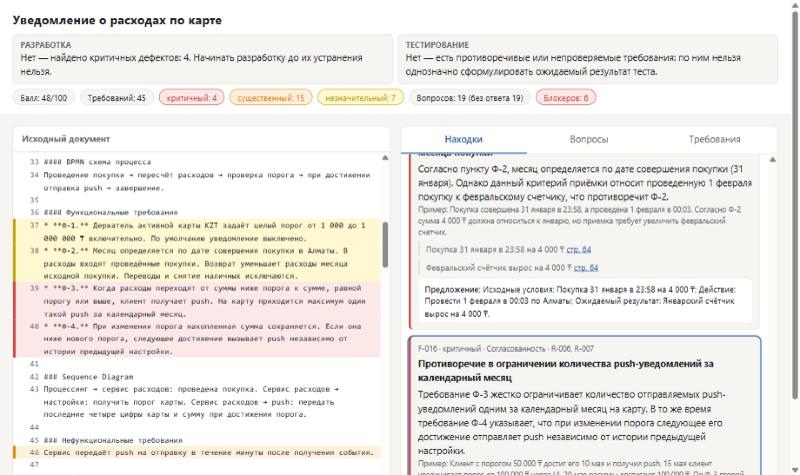

<p align="center">
  
</p>

<p align="center"><a href="https://github.com/mynbaev1989-cell/bcc-requirements-agent/actions/workflows/tests.yml"></a></p>

**reqcheck** — ИИ-агент, который проводит статическое ревью готового документа требований **до разработки**: выделяет отдельные требования, оценивает каждое и весь набор по ISO/IEC/IEEE 29148:2018 (п. 5.2.5, 5.2.6) и IEEE Std 830-1998 (п. 4.3), задаёт автору уточняющие вопросы и учитывает его ответы, а потом пишет отчёт на русском в Markdown, PDF, JSON и интерактивном HTML, а вопросы автору — ещё и в CSV для импорта в Jira. Каждое нарушение привязано к строке документа. Цитаты сверяет с исходным текстом код, а не модель.

Отборочное задание BCC-HUB × MNU FinTech Hackathon, кейс [ai-requirements-validator-task](https://github.com/BCC-HUB/ai-requirements-validator-task).

**Проверить за 2 минуты:** [что агент нашёл в документе кейса](#отчёт-по-выданному-документу) · [какие вопросы задал автору](reports/requirements_report_questions.md) · [как ответы меняют вердикт](#отчёт-по-выданному-документу) (4 критичных → 2) · [насколько точен](#точность-на-размеченных-документах) · [как устроен](#как-устроен-агент) · [где в коде каждый пункт ТЗ](#соответствие-тз). Без ключа и сети: `python main.py --input eval_holdout/holdout_deposit.md --output out/report.md --offline`.

**Главное в цифрах** (7 размеченных документов, 104 дефекта, всё пересчитывается скриптами из закоммиченного кэша):
- найдено **100 из 104** дефектов, полнота 96% [92–99%], точность находок 86% [82–90%];
- **один промпт в ту же модель находит 53 из 104**, в более сильную gemini-3.5-flash — 66 из 104 ([замер](#чем-это-лучше-чем-вставить-тз-в-чат));
- вопрос автору задан по **всем 77** найденным критичным и существенным дефектам, у каждого — варианты ответа и адресат;
- критичность агента совпадает со вторым разметчиком в 74% (κ 0,58) — на уровне двух разметчиков между собой (71%);
- прогон документа кейса — 12 запросов к модели и ≈ **$0,11** по замеренным токенам.

## Отчёт по выданному документу

Сформирован агентом по `docs/requirements.md` из репозитория кейса, без ручных правок:

- [`reports/requirements_report.md`](reports/requirements_report.md) — основной отчёт
- [`reports/requirements_report.pdf`](reports/requirements_report.pdf) — PDF-версия
- [`reports/requirements_report.json`](reports/requirements_report.json) — машиночитаемая версия
- [`reports/requirements_report_questions.md`](reports/requirements_report_questions.md) — вопросы агента автору, файл для ответов
- [`reports/requirements_report.html`](reports/requirements_report.html) — интерактивный отчёт одним файлом, работает без сети: скачайте и откройте в браузере
- [`reports/requirements_report_jira.csv`](reports/requirements_report_jira.csv) — вопросы автору для импорта в Jira: задача на вопрос, приоритет, роль адресата, цитаты со строками

<p align="center">
  
</p>

В HTML-отчёте клик по находке прокручивает документ к её строке, строки подсвечены по критичности, есть фильтр. Во вкладке «Вопросы» автор выбирает вариант ответа или пишет свой, а кнопка «Скачать ответы» сохраняет файл в формате `_questions.md` — его сразу принимает `--answers`.

Отчёт собран версией `7cfaaac` (указана в паспорте).

**Итог по документу кейса «Уведомление о расходах по карте»:** 45 требований, 26 находок (критичных 4, существенных 15, мелких 7), 19 вопросов автору, из них 6 блокируют разработку. Балл документа 48 из 100. Вердикт: **разработку и тестирование начинать нельзя**, пока не сняты критичные дефекты:

| Находка | Строки | Суть |
| --- | --- | --- |
| F-003 | 52 | требование к интеграции противоречит спецификации REST API |
| F-005 | 64 | критерий приёмки противоречит бизнес-правилу Ф-2 о том, к какому месяцу относится покупка |
| F-016 | 39, 40 | Ф-3 разрешает один push в месяц, а Ф-4 требует новый push после смены порога |
| F-017 | 103, 104, 120 | настройка сохраняется методом GET, хотя операция изменяет данные |

Все четыре критичные находки мы вручную сверили с текстом документа, все четыре — противоречия. Тест на строке 64 относит покупку 31 января к февралю вопреки Ф-2. Ф-4 обещает push после смены порога, а Ф-3 разрешает не больше одного push в месяц. Сохранение идёт методом GET. Метода чтения, на который ссылается строка 52, в спецификации нет. «Нет URL для Prod» теперь существенная находка: это неполнота без конфликта, её понижает калибровка критичности кодом ([`severity.py`](reqcheck/severity.py)).

Модели: gemini-3.5-flash, после исчерпания её дневной квоты — gemini-3.5-flash-lite (агент переключился сам, в паспорте указаны обе). Первый полный прогон занял около 4 минут. Отчёт в `reports/` пересобран той же командой на коммите, указанном в паспорте, с ответами модели из локального кэша первого прогона: поэтому находки те же, а запросов к LLM в паспорте 0. Кэша в репозитории нет, поэтому прогон на чистом клоне снова спросит модель, и формулировки находок могут немного отличаться.

**Цикл уточнения на этом документе.** Мы ответили от лица автора на три блокирующих вопроса: метод GET → POST, код ответа для чужой карты 404, ошибка валидации → HTTP 400. Затем запустили агента с `--answers`:

```powershell
python main.py --input input/requirements.md --output reports/demo_answers/report_after_answers.md --answers reports/demo_answers/answers.md
```

| | До ответов | После 3 ответов |
| --- | ---: | ---: |
| Критичных находок | 4 | 2 |
| Существенных находок | 20 | 14 |
| Блокирующих вопросов без ответа | 5 | 2 |
| Находок закрыто ответами | — | 8 |

Решение получено по всем 8 находкам, связанным с отвеченными вопросами. Этот отчёт собран версией из `main`, к вопросам которой писались ответы (коммит в паспорте): в ветке вопросы и их номера другие. Файлы: [`answers.md`](reports/demo_answers/answers.md) (ответы-пример, их написали мы, а не автор документа), [`report_after_answers.md`](reports/demo_answers/report_after_answers.md) (таблица «Находки, закрытые ответами автора» в Приложении A).

## Точность на размеченных документах

Агента проверяли на 7 синтетических документах в стиле банковского ТЗ с заранее размеченными дефектами (дословная цитата, строка, тип, критичность). [`tools/eval_score.py`](tools/eval_score.py) сверяет находки агента с разметкой, [`tools/ablation.py`](tools/ablation.py) пересчитывает всё из кэша, без запросов к модели.

| Набор | Документов | Найдено дефектов | Вопрос автору задан | Точность находок | С учётом реальных дефектов вне разметки | Ложные critical/major на корректных требованиях |
| --- | ---: | ---: | ---: | ---: | ---: | ---: |
| [`eval/`](eval/) — на нём настраивали агента | 3 | 40 из 41 | 40 из 41 | 87% (по пунктам 84%) | 97% | 2 |
| [`eval_holdout/`](eval_holdout/) — агент его не видел | 2 | 30 из 31 | 30 из 31 | 88% (по пунктам 86%) | 90% | 1 |
| [`eval_blind/`](eval_blind/) — слепой: написал и разметил другой ИИ, не видевший код и промпты | 2 | 30 из 32 | 30 из 32 | 81% | 91% | 4 |
| **Всего** | 7 | **100 из 104** | **100 из 104** | **86% (по пунктам 84%)** | **94%** | 7 |
| Только правила, без LLM (`--offline`) | 7 | 38 из 104 | 38 из 104 | 70% | 78% | — |

Модель gemini-3.5-flash-lite, живой прогон 27.11.2026; `python tools/ablation.py` пересчитывает всё из его кэша. Ответы модели для этого замера лежат в репозитории ([`eval/llm_cache/`](eval/llm_cache/), 86 файлов, 0,7 МБ), и CI на каждом коммите пересчитывает точность без сети и без ключа: `python tools/ablation.py --cache eval/llm_cache --gate` падает, если найдено меньше 100 дефектов, точность ниже 85%, есть ложный critical, которого нет ни в эталоне, ни среди подтверждённых дефектов вне разметки (`*.extra.json`), или хоть один ответ модели не нашёлся в кэше. В `main` порог был 102 и считался любой critical вне эталона; почему его снизили — ниже. Самая честная цифра — слепой набор: документы и разметку написал отдельный ИИ-агент (Claude), который не видел ни код, ни промпты, ни выводы reqcheck. Первый замер на нём — 29 из 32 и точность 80%. По разбору пропусков мы добавили два правила кода на классы ошибок: «лимит без периода действия» и «поле в примере JSON не совпадает с таблицей параметров» ([`rules.py`](reqcheck/rules.py)). Они нашли по одному дефекту на слепом и контрольном наборе и не сработали ни на одном корректном требовании, но слепой набор после этого уже не совсем слепой. Поэтому показываем обе цифры, а проверка без подгонки — следующий слепой набор. Пропущены 2 дефекта, оба — неполнота: не сказано, что делать с картой, заблокированной банком, и с недоставленным push.

- **Разброс.** Документов всего 7, поэтому цифры выше — точечные оценки. 95%-доверительные интервалы (bootstrap по документам, 10 000 повторов, [`tools/stats.py`](tools/stats.py)): полнота 96% [92–99%], точность 86% [82–90%], точное совпадение критичности 52% [43–61%], по ближайшей находке 63% [52–75%]. Повторная выборка идёт по документам, а не по дефектам: дефекты одного документа зависимы, и выборка по ним дала бы ложно узкий интервал.

- **Точность с учётом реальных дефектов вне разметки.** Мы вручную сверили с текстом все находки, не совпавшие с разметкой, и вынесли подтверждённые в `*.extra.json` рядом с документом (12 дефектов: незаполненные чек-листы, пустой раздел «TBD», требования без ID, неопределённые термины). Эталон при этом не менялся. Спорные находки засчитаны как ошибки.
- **Критичность.** Совпала с разметкой точно у 52% найденных дефектов (в `main` — 46%), по ближайшей находке — у 63%, с разницей не больше одного уровня — у 94%. Прирост дала калибровка кодом: неполноту, непроверяемую формулировку и TBD без противоречия код понижает с критичного до существенного ([`severity.py`](reqcheck/severity.py)). Чтобы понять потолок, 104 эталонных дефекта дали второму разметчику — отдельному ИИ-агенту (Claude), который видел только обезличенные пункты и нейтральную инструкцию по §6 ТЗ. Разметчики между собой совпали в 71% (κ Коэна 0,53). Агент со вторым разметчиком по ближайшей находке — в 74% (κ 0,58), то есть на уровне согласия разметчиков. С разметкой агент совпадает хуже (63%, κ 0,38): разметка чаще ставит противоречиям «существенный», а §6 ТЗ называет их критичными. Разбор — в [`eval/README.md`](eval/README.md#согласие-разметчиков-κ-коэна).
- **Ложный критичный — 1, и это реальный дефект.** «Противоречие формата загрузки реестра между ФТ и API» в `blind_payroll.md` (строки 28 и 63: CSV против JSON) записано в `blind_payroll.extra.json` — подтверждённые дефекты вне разметки. Метрика «ложные critical» в таблицах считает только эталон и показывает его как ложный, а ворота CI его не считают.
- **Цена убранной утечки.** Из промпта ConsistencyReviewer мы убрали фразы, совпадавшие с документом кейса («независимо от истории», «при изменении настройки»), и заменили их нейтральными. После этого агент перестал находить 2 дефекта: «GET-метод выполняет списание» в `p2p_phone.md` и «раздел "Отчётность" — заглушка» в `holdout_installments.md`. Найдено 100 из 104 вместо 102 — честная цифра без подгонки под кейс.
- **Вопросы.** По всем 77 найденным критичным и существенным дефектам задан вопрос. У 100% вопросов есть адресат, варианты ответа, допущение «если ответа не будет» и номер строки. Вопросов 108 на 100 найденных дефектов (1,08 на дефект): сходные дефекты собираются в один вопрос, а не дробятся. Все 35 блокеров — закрытые, с вариантами ответа. 55% вопросов адресованы не аналитику по умолчанию, а тому, кто принимает решение. Почти одинаковых формулировок (сходство текста выше 0,8) — 0; пар вопросов на одни и те же строки — 3. Считает `tools/eval_score.py` (`question_quality`), те же цифры даёт `tools/ablation.py` из кэша.
- **Сбои модели.** Один запрос на `blind_payroll.md` (половина повторного запроса Reviewer) не дал корректного ответа и в живом прогоне: часть требований этого документа осталась без оценки модели, агент пишет это в диагностике.

Сводная находка об атомарности засчитывается, если совпал хотя бы один её пункт; в скобках та же точность без этого послабления. Разметку `eval/` и `eval_holdout/` делал автор проекта. Аблация (вклад каждого агента) и разбор ошибок — в [`eval/README.md`](eval/README.md).

## Быстрый старт

Нужен Python 3.11+ (этого требует `google-genai`).

**1. Установить зависимости**

```powershell
git clone https://github.com/mynbaev1989-cell/bcc-requirements-agent.git
cd bcc-requirements-agent
python -m venv .venv
.venv\Scripts\activate          # Linux/macOS: source .venv/bin/activate
pip install -r requirements.txt   # для тестов: requirements-dev.txt
```

**2. Получить ключ LLM** — бесплатно в Google AI Studio: [aistudio.google.com/apikey](https://aistudio.google.com/apikey) → **Create API key** → **Copy key**. Платный тариф не нужен.

**3. Положить ключ** — в файл `.env` в корне репозитория (шаблон — [`.env.example`](.env.example)); файл `.env` в git не попадает:

```text
GEMINI_API_KEY=ваш_ключ
```

или переменной окружения: `$env:GEMINI_API_KEY="…"` (PowerShell) / `export GEMINI_API_KEY=…` (bash). Ключ нигде не печатается и не пишется в отчёт.

**4. Запустить прогон одной командой** — путь к документу и путь к отчёту:

```powershell
python main.py --input input/requirements.md --output reports/requirements_report.md
```

Короткая форма той же команды: `python -m reqcheck input/requirements.md reports/requirements_report.md`.

Документ кейса можно скачать так:

```powershell
curl -o input/requirements.md --create-dirs https://raw.githubusercontent.com/BCC-HUB/ai-requirements-validator-task/main/docs/requirements.md
```

**5. Куда ляжет отчёт** — по пути из `--output` (`reports/requirements_report.md`), рядом с тем же именем — `.pdf`, `.json`, `.html` (интерактивный отчёт), `_questions.md` с вопросами автору и `_jira.csv` для импорта вопросов в Jira. Если путь оканчивается на `.pdf`, основным будет PDF.

**6. Ответить на вопросы агента (по желанию)** — впишите ответы после «Ответ:» в `reports/requirements_report_questions.md` и запустите повторно:

```powershell
python main.py --input input/requirements.md --output reports/requirements_report.md --answers reports/requirements_report_questions.md
```

Модель по умолчанию — `gemini-3.5-flash`. Опции: `--model` (другая модель Gemini), `--answers` (файл с ответами автора), `--offline` (без LLM, только правила), `--formats md,pdf,json,html,csv`, `--max-size-mb 20`, `--timeout`, `--no-cache`, `--no-critic`. Коды выхода: `0` — проверка выполнена; `1` — документ не удалось проверить, но отчёт с диагностикой записан; `2` — отчёт не записан; `3` — неверные аргументы.

Поддерживаемые входы: **PDF** (с текстовым слоем), **MD**, **TXT** (UTF-8/UTF-16/CP1251), **DOCX** (с автонумерацией Word: номера «1.2.», «ФТ-3.» из многоуровневого списка восстанавливаются, иначе они пропали бы из текста). Тип определяется по содержимому файла, а не по расширению.

## Как устроен агент

<p align="center">
  
</p>

Принцип: **всё, что можно посчитать кодом, считает код**; LLM оценивает только смысл, а её ответы проверяет код.

Зачем несколько агентов, а не один промпт — аблация на 7 размеченных документах из кэша ([`eval/README.md`](eval/README.md)):

- **LLM-агенты дают полноту:** только правила находят 38 из 104 дефектов, полный конвейер — 100 из 104. Без GapFinder теряются 2 дефекта (пропуски). Без ConsistencyReviewer в ветке найдено столько же: его уникальные находки пропали, когда из промпта убрали фразы кейса (см. выше).
- **Сверка цитат кодом даёт точность:** она отбросила 9 находок с цитатами, которых нет в документе; без неё точность падает с 86% до 82%, а ложных критичных становится 3 вместо 1.
- **Critic и слияние повторов убирают шум:** критик слил 9 дублей одного противоречия и не отклонил ни одной верной находки, код слил ещё 29 повторов между агентами. На точность это не влияет, но отчёт короче, и вопросов автору меньше.

Каждый шаг — отдельный агент с одной задачей: класс `Step` в [`steps.py`](reqcheck/steps.py). Порядок задаёт план `build_plan()`, выполняет его [`Orchestrator`](reqcheck/orchestrator.py):

- шаги одной стадии идут параллельно, а их результаты применяются строго в порядке плана, поэтому отчёт не зависит от того, какой агент ответил первым;
- если LLM недоступна или шаг упал, оркестратор пишет диагностику и включает запасной вариант шага на коде (он есть у извлечения требований, вопросов и учёта ответов), а остальные LLM-шаги пропускает; отчёт всё равно выходит;
- каждый шаг попадает в журнал агентов (Приложение E отчёта): стадия, агент, время, статус, итог.

Почему устроено именно так — шесть коротких записей архитектурных решений в [`docs/adr/`](docs/adr/README.md): конвейер вместо одного промпта, сверка цитат кодом, кэш по SHA промпта, пределы власти Critic, вердикт считает код, OpenAI-совместимый клиент.

| Стадия | Агент | Что делает | Запасной вариант |
| --- | --- | --- | --- |
| 1 | Loader (код) | MD/TXT/PDF/DOCX, тип по сигнатуре, лимиты размера, диагностика битых файлов | — |
| 2 | Segmenter + RuleEngine (код) | разделы, списки, строки таблиц, явные ID (`Ф-1`, `FR-2`, `4.2.1`); правила: размытые слова, заглушки, смешение единиц, нет версии, дубли ID | — |
| 3 | Подключение модели (код) | клиент Gemini или режим без LLM | только правила |
| 4 | Extractor (LLM) | атомарные требования из блоков; ID и цитату проверяет код | эвристика по структуре |
| 5 | Reviewer · Analyst · Analyst (LLM, параллельно) | 10 критериев на каждое требование; чек-лист и матрица трассируемости; черновики тест-кейсов | «не оценено» |
| 6 | ConsistencyReviewer + GapFinder (LLM) | противоречия между требованиями, критериями приёмки и API; пропуски набора | правила набора |
| 7 | Grounder + dedupe (код) | каждая цитата ищется в документе (точно и нечётко; части цитаты с «…» — по порядку и рядом друг с другом); находка без подтверждённой цитаты отбрасывается; дубли сливаются | — |
| 8 | Critic (LLM) | независимо перепроверяет находки: подтверждает, понижает или отклоняет | находки без перепроверки |
| 9 | Слияние повторов (код) | один дефект, найденный и Reviewer по требованию, и ConsistencyReviewer по набору, становится одной находкой: общее требование, строки цитат рядом, похожий заголовок; незначительные замечания «Единичность» сводятся в одну находку | — |
| 10 | Калибровка критичности (код) | «критичный» остаётся за конфликтами: находка о неясности или неполноте без противоречия понижается до «существенный» ([`severity.py`](reqcheck/severity.py)) | — |
| 11 | Нумерация (код) | порядок отчёта, ID находок `F-NNN` | — |
| 12 | Clarifier (LLM) | вопросы автору по критичным и существенным находкам | вопросы из находок кодом |
| 13–14 | Resolver (LLM) | только с `--answers`: какие находки ответ закрыл, какие нет | ответы сохраняются без решения |

Вердикт, баллы 0–100, приоритеты и оценку экономии считает код в [`pipeline.py`](reqcheck/pipeline.py), а не модель.

**Модель внутри контура банка.** Если документ нельзя отправлять в облако, агент работает с любой моделью с OpenAI-совместимым API (Ollama, vLLM, LM Studio): задайте `REQCHECK_LLM_BASE_URL=http://localhost:11434/v1` и `REQCHECK_LLM_MODEL=<модель>`, ключ Gemini не нужен ([`llm_openai.py`](reqcheck/llm_openai.py)). Если сервер не запущен, агент после первого отказа соединения не повторяет запросы, а за секунды переходит на запасные варианты шагов и пишет причину в диагностику отчёта. Конвейер, правила и сверка цитат от модели не зависят; качество на локальных моделях мы не замеряли.

**Встраивание в процесс.** [`examples/ci_gate.yml`](examples/ci_gate.yml) — шаг GitHub Actions, который проверяет ТЗ в pull request и падает, пока в документе есть критичные дефекты.

**Надёжность.** Температура 0, JSON-режим, локальный кэш ответов в `.reqcheck_cache/` (повторный прогон того же документа на той же машине не тратит квоту и даёт тот же отчёт; без кэша модель спрашивается заново), повторы с учётом `retryDelay` сервера, не больше 3 запросов к LLM одновременно, переход на запасную модель при 404 и исчерпанной дневной квоте (если модель не задана явно), а после исчерпания квоты — мгновенный переход шагов на запасные варианты без долгих повторов. Текст документа передаётся модели как данные: инструкции внутри документа игнорируются. Ответ каждой из 9 ролей сверяется с JSON Schema ([`schemas.py`](reqcheck/schemas.py)) в режиме наблюдения: нарушения считаются в статистике клиента, а ответ не меняется — исправлять его продолжает код шага. Все 86 закоммиченных ответов модели проходят схемы (тест). Если модель пропустила требование в пакете, Reviewer переспрашивает только о нём, а если пакет или переспрос не дал корректного ответа — делит его пополам и повторяет один раз (кроме исчерпанной квоты); что не оценено и после этого, попадает в диагностику, и вердикт тогда не может быть «Да».

**Защита от плохого входа.** Документ приходит извне, поэтому агент считает его недоверенным:

- огромный или битый файл — лимит размера (`--max-size-mb`), тип по сигнатуре, лимит страниц PDF, разбор PDF/DOCX в отдельном потоке с таймаутом ([`loaders.py`](reqcheck/loaders.py));
- зависший запрос — таймаут (`--timeout`), не больше 40 запросов на прогон ([`llm.py`](reqcheck/llm.py));
- инструкции для ИИ внутри документа — модели получают его как данные, а строки вида «игнорируй предыдущие инструкции» код выносит в диагностику `PROMPT_INJECTION_SUSPECTED` ([`rules.injection_lines`](reqcheck/rules.py)); правила и сверка цитат от модели не зависят, а находка без цитаты из документа отбрасывается;
- ключ API — только из `GEMINI_API_KEY` или `.env` (в `.gitignore`), ни отчёт, ни журнал его не содержат.

## Уточнение требований

Агент не только находит дефект, но и спрашивает, как его исправить. [`Clarifier`](reqcheck/clarify.py) превращает находки в короткий список вопросов: один вопрос — одно решение. Что гарантирует код:

- каждый вопрос привязан к реальной находке и строкам документа;
- каждый критичный дефект покрыт вопросом с приоритетом «блокирует разработку»;
- блокирующий вопрос не связывает критичные дефекты из разных мест документа (дальше 5 строк друг от друга): такой вопрос код разбивает на отдельные, потому что одним ответом автор его не закроет;
- блокирующие вопросы никогда не отсекаются лимитом в 20 вопросов;
- мелкие находки, на которые не хватило отдельного вопроса, собираются в один сводный вопрос «принять исправления или оставить как есть», поэтому каждую находку отчёта можно закрыть ответом;
- у каждого вопроса есть допущение на случай, если ответа не будет, а у вопроса по находке с исправлением — варианты ответа, даже если модель их не дала.

Так выглядит вопрос агента — реальный вывод по документу кейса ([`requirements_report_questions.md`](reports/requirements_report_questions.md)):

```text
## Q-02 · блокирует разработку · Кому: Бизнес-заказчик

Вопрос: В пункте Ф-2 месяц определяется по дате совершения покупки (31 января), но в таблице критериев приёмки (строка 64) покупка от 31 января относит проведенную 1 февраля операцию к февралю. По какой дате относится покупка к счетчику месяца?
Почему важно: Неверный расчет расходов клиента за месяц и ошибочное срабатывание/несрабатывание push-уведомлений.
Варианты: (1) По дате совершения операции (транзакции); (2) По дате проведения (клиринга/списания)
Если ответа не будет: Расчет месячного счетчика ведется строго по дате совершения операции.
Находки: F-005 (строки: 64)
Ответ:
```

Цикл уточнения:

1. Первый прогон пишет вопросы в `<отчёт>_questions.md` и в Приложение A отчёта, с черновиком письма адресатам.
2. Автор вписывает ответы и запускает агента с `--answers`.
3. [`Resolver`](reqcheck/clarify.py) решает по каждой находке: закрыта, частично снята или открыта. Закрытые находки уходят из вердикта в отдельную таблицу «Находки, закрытые ответами автора», по открытым агент задаёт уточнение (`Q-01.1`).

Код страхует и этот шаг: формулировка модели без значения, выбранного автором, отклоняется; ответ, противоречащий документу, другому ответу или самому себе, оставляет находку открытой (самопротиворечие модель называет двумя цитатами из ответа, код сверяет их дословно); пропущенную находку Resolver переспрашивает, а без решения помечает «проверьте вручную»; изменение документа после ответов ловит сверка SHA-256.

**Проверка на чужих ответах.** Ответы в демо выше писали мы. Чтобы проверить Resolver честно, на вопросы по документу кейса ответил отдельный ИИ-агент, не видевший кода: 6 ответов конкретных, 2 уклончивых, 2 противоречивых. Агент верно обработал 9 из 10: все конкретные ответы закрыли находки (10 штук), уклончивые и один противоречивый оставили находки открытыми и породили уточнения `Q-xx.1`. Ошибся на противоречии внутри одной фразы. Критичных находок стало 1 вместо 4. Тот же агент ответил на вопросы по двум слепым документам (18 ответов): верно 16 — все 11 конкретных, 4 уклончивых и 1 из 3 противоречивых. Итого на 28 чужих ответах: конкретные 17 из 17, уклончивые 6 из 6, противоречивые 2 из 5. Самопротиворечие внутри одного ответа лёгкая модель замечает не всегда — это главный резерв точности. Разбор и файлы — в [`reports/independent_answers/`](reports/independent_answers/README.md). В итоге отчёта видно, что изменили ответы: «критичных было 4 → стало 2».

## Чем это лучше, чем вставить ТЗ в чат

Мы замерили это, а не рассуждаем. [`tools/baseline_single_prompt.py`](tools/baseline_single_prompt.py) отправляет в модель каждый из 7 размеченных документов целиком одним запросом. Промпт — хороший промпт аналитика: роль, критерии из §6 ТЗ, требование дать цитату, строку и вопрос автору. Ответ сверяется с той же разметкой по тому же правилу, что и находки reqcheck. Ответы модели лежат в [`eval/llm_cache_baseline/`](eval/llm_cache_baseline/), поэтому замер повторяется без сети: `python tools/baseline_single_prompt.py --cache eval/llm_cache_baseline`.

| На 7 документах (104 дефекта) | Один промпт, flash-lite | Один промпт, flash | reqcheck, flash-lite |
| --- | ---: | ---: | ---: |
| Найдено дефектов | 53 (51%) | 66 (63%) | **100 (96%)** |
| Находок в отчёте | 48 | 59 | 173 |
| Точность находок | 94% | 93% | 86% |
| Ложных critical вне разметки и `extra.json` | 0 | 2 | 0 |
| Цитаты из документа | 94% нашлись, но никто не проверяет | 96% нашлись, но никто не проверяет | сверяет код; 9 находок с выдуманными цитатами отброшены |
| Вопрос по каждому критичному и существенному дефекту, с вариантами | нет | нет | 77 из 77 |

Один промпт пишет короткий список очевидного, поэтому его точность выше, а полнота — вдвое ниже: половина дефектов в отчёт не попадает. Даже более сильная модель одним запросом пропускает треть. reqcheck находит почти все, а цену в точности (86% против 94%) платит находками, которые человек отсеет за секунды по цитате и строке.

| Просто чат с LLM | reqcheck |
| --- | --- |
| Ответ в свободной форме, каждый раз разный | Фиксированная структура отчёта по разделу 6 ТЗ, температура 0, кэш |
| Ссылки на «пункт 3» могут быть выдуманы | Цитаты сверяются с документом кодом, у каждой — номер строки; неподтверждённые находки отбрасываются (счётчик в отчёте) |
| Одна модель — одно мнение | Отдельный агент-критик перепроверяет находки |
| Вопросы — по желанию модели | Вопрос к каждому критичному дефекту с адресатом, вариантами и допущением; ответы учитываются повторным прогоном |
| Номера требований — как получится | Нарезка с ID из документа или присвоенными R-NNN и дословной цитатой |
| Битый PDF или скан — ошибка | Понятная диагностика в отчёте и код выхода, без падения |
| Нет вердикта | Вердикт «можно ли начинать разработку и тестирование», приоритеты, тест-кейсы |

## Соответствие ТЗ

| Требование ТЗ (README кейса) | Где реализовано | Чем подтверждено |
| --- | --- | --- |
| §1 Статическая проверка документа требований и отчёт | [`pipeline.run`](reqcheck/pipeline.py), [`Orchestrator`](reqcheck/orchestrator.py) | `test_full_run_with_fake_llm` |
| §3.2 Вход: PDF + другие форматы | [`loaders.load_document`](reqcheck/loaders.py) | `test_text_pdf`, `test_docx`, `test_cp1251_text_is_decoded`, документ кейса в PDF — [`test_case_pdf.py`](tests/test_case_pdf.py) |
| §3.3 Выделение отдельных требований | [`segmenter.segment`](reqcheck/segmenter.py), [`ExtractStep`](reqcheck/steps.py) | `test_segment_structure`, `test_explicit_ids`, `test_extractor_empty_falls_back_to_heuristic` |
| §3.4 Проверка набора целиком | [`SetCheckStep`](reqcheck/steps.py) → [`ConsistencyReviewer`](reqcheck/agents.py), [`RuleEngine.run_set_rules`](reqcheck/rules.py) | `test_rules_find_generic_defects`, `test_gaps_kept_when_only_consistency_fails` |
| §3.5 Запись отчёта в файл | [`pipeline.write_outputs`](reqcheck/pipeline.py) | `test_full_run_with_fake_llm` (MD, PDF, JSON) |
| §4 Любая LLM, модель указана | [`llm.GeminiClient`](reqcheck/llm.py), этот README, паспорт отчёта | поле «Модель» в отчёте |
| §5 Критерии 29148 п. 5.2.5/5.2.6, IEEE 830 п. 4.3 | [`criteria.py`](reqcheck/criteria.py) | каждое нарушение в отчёте подписано пунктом стандарта |
| §6 Отчёт на русском, файл | [`report_md.py`](reqcheck/report_md.py), [`report_pdf.py`](reqcheck/report_pdf.py), [`report_html.py`](reqcheck/report_html.py), [`report_jira.py`](reqcheck/report_jira.py) | [`reports/`](reports/), эталон [`tests/golden/`](tests/golden/) |
| §6 Паспорт прогона: документ, дата, модель, версия агента | раздел 1 отчёта, [`pipeline.agent_version`](reqcheck/pipeline.py) (`git describe`) | `test_full_run_with_fake_llm` |
| §6 Таблица нарезки «ID в отчёте — ID в документе — формулировка», свои ID + цитата | раздел 2 отчёта | `test_full_run_with_fake_llm` (ID присвоен строке таблицы без номера) |
| §6 Проверка каждого требования / всего набора | разделы 3 и 4 отчёта | `test_full_run_with_fake_llm` |
| §6 Сводка: число требований, нарушений, критичные дефекты | раздел 5 отчёта (непроверяемые / противоречивые / неполные) | [`reports/`](reports/) |
| §6 Итог: можно ли начинать разработку и тестирование, что исправить первым | раздел 6 отчёта, [`pipeline._finalize`](reqcheck/pipeline.py) | `test_full_run_with_fake_llm` |
| §6 Без общих фраз, каждое нарушение ссылается на место | [`grounding.Grounder`](reqcheck/grounding.py), [`GroundStep`](reqcheck/steps.py) | `test_grounding_exact_fuzzy_and_hallucination`, `test_full_run_with_fake_llm` (выдуманная цитата отброшена) |
| §7 Код и файл зависимостей | [`reqcheck/`](reqcheck/), [`requirements.txt`](requirements.txt) | — |
| §7 README: ключ, куда положить, команда, куда отчёт | [Быстрый старт](#быстрый-старт) | — |
| §7 Запуск одной командой: путь к документу и к отчёту | [`cli.py`](reqcheck/cli.py) | `test_cli_ok_and_bad_args`, [`test_cli_e2e.py`](tests/test_cli_e2e.py) |
| §7 Секреты не в репозитории, `.env.example` в корне | [`.env.example`](.env.example), [`.gitignore`](.gitignore) | ключ только из `GEMINI_API_KEY` |
| Кикофф: повреждённые файлы и файлы без текста → диагностика, без аварийного завершения | [`loaders.py`](reqcheck/loaders.py), [`pipeline.run`](reqcheck/pipeline.py) | `test_broken_inputs_raise_diagnostic` (7 случаев), `test_truncated_pdf`, `test_scanned_pdf_without_text`, `test_encrypted_pdf`, `test_cli_broken_file_writes_diagnostic_report`, 20 плохих документов в [`test_robustness.py`](tests/test_robustness.py) |

Разделы отчёта 1–6 идут строго в порядке раздела 6 ТЗ (проверяется тестом). Всё сверх ТЗ — в приложениях после «Итога»: **A** вопросы автору, ответы и черновик письма; **B** заполненный чек-лист ревью из документа; **C** черновики недостающих критериев приёмки «Дано / Когда / Тогда»; **D** матрица трассируемости «требование → критерий → API»; **E** журнал агентов, нагрузка на LLM, отброшенные находки, бизнес-ценность.

## Бизнес-ценность

**Главное — время ревью, его можно проверить.** По документу кейса (45 требований, 29 находок; Приложение E отчёта):

| Эффект | Часы | Тенге |
| --- | ---: | ---: |
| Ручное ревью без агента: 30 мин + 6 мин × 45 требований | 5,0 ч | — |
| Проверка отчёта агента человеком: 1,5 мин × 29 находок | 0,7 ч | — |
| **Экономия времени ревью** (первый прогон агента — около 4 минут) | **≈ 4,3 ч** | **≈ 21 400 ₸** |
| Стоимость LLM (бесплатный тариф) | — | 0 ₸ |

**Цена прогона — замер.** Живой прогон документа кейса без кэша (gemini-3.5-flash-lite, 27.11.2026): 12 запросов, 68 491 входной токен, 22 588 выходных и 11 908 токенов «размышления» (из паспорта отчёта, поле `metrics`). По цене gemini-3.5-flash-lite на [странице цен Google](https://ai.google.dev/gemini-api/docs/pricing) ($0,30 за 1 млн входных, $2,50 за 1 млн выходных токенов, «размышление» оплачивается как выход) это 0,021 + 0,086 ≈ **$0,11 за документ**. Повторный прогон без кэша дал 37 требований и 22 находки (3 критичных) вместо 45 и 26: модель недетерминирована даже при температуре 0, поэтому отчёт кейса закреплён кэшем и паспортом; главные противоречия (строка 64, GET на строках 104 и 120, строки 39–40) нашлись в обоих прогонах.

**Оценка по кэшу — сверка.** По закоммиченному кэшу (`python tools/cost_estimate.py`, без сети) полный конвейер тратит на документ в среднем 12,3 запроса: промпты ≈ 38–51 тыс. токенов, ответы ≈ 18–24 тыс. (токены оценены по символам, 3–4 символа на токен). По цене gemini-3.5-flash-lite на [странице цен Google](https://ai.google.dev/gemini-api/docs/pricing) на 27.11.2026 ($0,30 за 1 млн входных и $2,50 за 1 млн выходных токенов) это ≈ $0,06–0,08 за документ. Токены «размышления» модели в кэш не попадают и в оценку не вошли, поэтому реальная цифра может быть выше; на отдачу это почти не влияет — она определяется временем человека.

Время агента замеряется, остальное — явные допущения. Уже одно время ревью окупает проверку отчёта почти в 6 раз; это нижняя граница выгоды, переделки в ней не учтены.

**Переделки, которых удалось избежать, — оценка, а не замер.** Дефект требований, найденный до разработки, правится примерно за час. Найденный при разработке, он стоит дороже: по данным NASA ([Stecklein et al., 2004/2010](https://ntrs.nasa.gov/citations/20100036670)) в 7–16 раз на этапе кодирования и в 21–78 раз на интеграции и тестах. Есть и контрданные: на 171 проекте рост стоимости оказался непостоянным ([Menzies et al., 2016](https://arxiv.org/abs/1609.04886)). Поэтому отчёт показывает три сценария по одной формуле:

```text
переделки = (критичные + 0,5 × существенные) × точность × 1 ч × (удорожание − 1)
```

| Сценарий | Удорожание | Точность находок | Переделки | Выгода всего | Отдача |
| --- | ---: | ---: | ---: | ---: | ---: |
| Только время ревью | — | — | 0 ч | ≈ 21 400 ₸ | ×5,9 |
| Осторожный | ×3 | 0,7 | 19,6 ч | ≈ 119 400 ₸ | ×32,9 |
| Основной | ×7 (нижняя граница NASA) | 0,85 (замер) | 71,4 ч | ≈ 378 400 ₸ | ×104,4 |

Полвеса у существенных дефектов: не каждый доходит до кода. Точность 0,85 — замер на 5 документах настройки и контроля (по пунктам; со слепым набором 0,84); осторожный сценарий берёт 0,7. Выгода основного сценария падает вдвое при удорожании около ×3,8 вместо ×7. Ставка 5 000 ₸/ч; отдача = выгода / (стоимость LLM + время человека на проверку отчёта). Все параметры задаются переменными окружения, список — в [`reqcheck/value.py`](reqcheck/value.py).

## Тесты

```powershell
pip install -r requirements-dev.txt
python -m pytest -q --cov=reqcheck
```

940 тестов, покрытие строк `reqcheck/` 99%. В настоящую модель тесты не ходят: используется подставная `FakeLLM`. [GitHub Actions](.github/workflows/tests.yml) гоняет их на каждый push на Ubuntu и Windows, Python 3.11 и 3.12, падает при покрытии ниже 90% и делает офлайн-прогон агента. Там же линтер `ruff` ([`ruff.toml`](ruff.toml)) и `mypy --strict` для модулей, от которых зависит достоверность отчёта: модели данных и сверка цитат ([`mypy.ini`](mypy.ini)). Перед сдачей проект собран из чистого клона в новом окружении.

| Что проверяется | Файл | Тестов |
| --- | --- | ---: |
| Мусор от модели: 9 ролей × 15 видов ответа (None, не тот тип, выдуманные ID и цитаты, 200 КБ), 20 плохих документов, 8 файлов ответов — прогон не падает, отчёт пишется, выдуманное отброшено | [`test_robustness.py`](tests/test_robustness.py) | 172 |
| Инварианты: каждый критичный дефект покрыт вопросом, вердикт не «Да» при неполной проверке, нет находок без цитаты, балл совпадает с отметками, результат не зависит от порядка ответов агентов и `PYTHONHASHSEED` | [`test_invariants.py`](tests/test_invariants.py) | 82 |
| CLI: команда формы `main.py --input … --output …` и короткая форма, коды выхода 0–3, кириллица и пробелы в путях, `--offline`, `--answers`, `--formats`, отчёт не пишется поверх входа | [`test_cli_e2e.py`](tests/test_cli_e2e.py), [`test_main_entry.py`](tests/test_main_entry.py) | 58 |
| Золотой отчёт: MD и JSON сравниваются с эталоном; документ кейса, превращённый в PDF, даёт те же ID Ф-1…Ф-4 | [`test_golden.py`](tests/test_golden.py), [`test_case_pdf.py`](tests/test_case_pdf.py) | 21 |
| Разметка замера точности: цитаты и строки эталонов во всех 7 документах сходятся с текстом, аблация меряет все размеченные папки | [`test_eval_labels.py`](tests/test_eval_labels.py) | 9 |
| Новое к сдаче: 2 правила кода и их несрабатывание на корректных требованиях всех 7 документов (28), клиент локальной модели без сети, в том числе незапущенный сервер (27), разбиение запроса Reviewer пополам при сбое и неизменность запросов при успехе (6), метрики замера (4), ворота CI (3), сводный вопрос по мелким находкам (5), ответ, противоречащий сам себе (4), таблица агентов и схема в README совпадают с `build_plan()` (4) | [`test_rules_new.py`](tests/test_rules_new.py), [`test_llm_openai.py`](tests/test_llm_openai.py), [`test_reviewer_split.py`](tests/test_reviewer_split.py), [`test_eval_metrics.py`](tests/test_eval_metrics.py), [`test_ci_gate.py`](tests/test_ci_gate.py), [`test_minor_batch.py`](tests/test_minor_batch.py), [`test_self_contradiction.py`](tests/test_self_contradiction.py), [`test_readme_architecture.py`](tests/test_readme_architecture.py) | 81 |
| Модули по отдельности: загрузчики, нарезка, правила, сверка цитат, клиент LLM, критерии, вопросы и ответы, оценка ценности | [`test_units.py`](tests/test_units.py) и файлы по модулям | 445 |

Тесты нашли и закрыли 6 ошибок, на каждую есть регрессионный тест: нечёткая цитата получала строку на две выше настоящей; в PDF без маркеров списка пункты «Ф-1.»…«Ф-4.» склеивались и теряли ID; «Версия документа: 1.0» не считалась версией; критичный дефект давал тестировщикам вердикт лучше существенного; при сбое Reviewer критерий с находкой правил показывался «не оценено»; порядок строк в таблице нагрузки на LLM зависел от того, какой параллельный агент ответил первым.

## Ограничения

- PDF без текстового слоя (скан) не распознаётся: агент сообщает об этом и просит текстовый PDF или OCR.
- Бесплатный тариф `gemini-3.5-flash` — 20 запросов в сутки; документ на 40–45 требований тратит 12–14. Когда квота кончилась, агент дописывает отчёт запасными вариантами и пишет об этом в диагностике; можно взять `--model gemini-3.5-flash-lite` с отдельной квотой.
- Примерно каждая седьмая находка не совпадает с разметкой (каждая четырнадцатая — если засчитать подтверждённые дефекты вне разметки): отчёт стоит просмотреть человеку, время на это заложено в оценку экономии.
- Размеченных документов 7, все синтетические: 5 разметил автор проекта, 2 — отдельный ИИ-агент. Разметки живыми аналитиками банка пока нет. Оценка переделок — модель с допущениями, а не замер в банке.

## Структура

```text
reqcheck/              код агента
  cli.py, pipeline.py  запуск одной командой; план → оркестратор → вердикт → отчёт
  orchestrator.py, steps.py   движок шагов (параллельные стадии, запасные варианты, журнал) и сами агенты-шаги
  agents.py, clarify.py       LLM-агенты: Extractor, Reviewer, Consistency, Critic, Analyst; Clarifier и Resolver
  loaders.py, segmenter.py, rules.py, grounding.py   чтение, нарезка, правила, сверка цитат
  llm.py, prompts.py, value.py   клиент Gemini, промпты, бизнес-ценность
  severity.py                 калибровка критичности кодом
  report_md.py, report_pdf.py, report_html.py, report_jira.py   отчёт: Markdown, PDF, интерактивный HTML, CSV для Jira
tests/                 pytest (подставная FakeLLM), tests/golden/ — эталон отчёта
eval/, eval_holdout/, eval_blind/   размеченные документы; tools/eval_score.py, tools/ablation.py — замер точности
tools/baseline_single_prompt.py   базовая линия «один промпт» на тех же документах
reports/               отчёт агента по документу кейса
```
