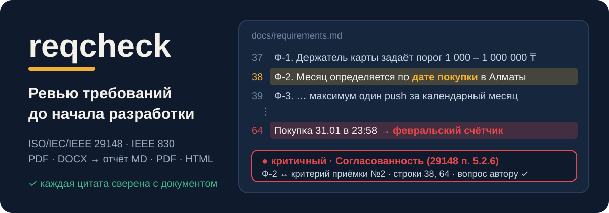

<p align="center">
  
</p>

<p align="center"><a href="https://github.com/mynbaev1989-cell/bcc-requirements-agent/actions/workflows/tests.yml"></a></p>

**reqcheck** — ИИ-агент, который проводит статическое ревью готового документа требований **до разработки**: выделяет отдельные требования, оценивает каждое и весь набор по ISO/IEC/IEEE 29148:2018 (п. 5.2.5, 5.2.6) и IEEE Std 830-1998 (п. 4.3), задаёт автору уточняющие вопросы и учитывает его ответы, а потом пишет отчёт на русском в Markdown, PDF и JSON. Каждое нарушение привязано к строке документа. Цитаты сверяет с исходным текстом код, а не модель.

Отборочное задание BCC-HUB × MNU FinTech Hackathon, кейс [ai-requirements-validator-task](https://github.com/BCC-HUB/ai-requirements-validator-task).

## Отчёт по выданному документу

Сформирован агентом по `docs/requirements.md` из репозитория кейса, без ручных правок:

- [`reports/requirements_report.md`](reports/requirements_report.md) — основной отчёт
- [`reports/requirements_report.pdf`](reports/requirements_report.pdf) — PDF-версия
- [`reports/requirements_report.json`](reports/requirements_report.json) — машиночитаемая версия
- [`reports/requirements_report_questions.md`](reports/requirements_report_questions.md) — вопросы агента автору, файл для ответов

<!-- RESULTS -->

## Точность на размеченных документах

Агента проверяли на синтетических документах в стиле банковского ТЗ с заранее размеченными дефектами: дословная цитата, номер строки, тип, критичность. Скрипт [`tools/eval_score.py`](tools/eval_score.py) запускает агента и сверяет его находки с разметкой.

| Набор | Документов | Найдено дефектов | Точность находок | Ложные critical/major на корректных требованиях | Дефектов с вопросом автору |
| --- | ---: | ---: | ---: | ---: | ---: |
| [`eval/`](eval/) — на нём настраивали агента | 3 | 41 из 41 (100%) | 86% | 1 | 36 из 41 |
| [`eval_holdout/`](eval_holdout/) — независимый, агент его не видел | 2 | 30 из 31 (97%) | 86% | 1 | 29 из 31 |

Модель gemini-3.5-flash-lite, 26.11.2026. Честная цифра — контрольный набор: его написали после настройки, и под него ничего не подгоняли. Точность — доля находок агента, совпавших с разметкой. Это нижняя граница: часть «лишних» находок — реальные дефекты, которых нет в разметке. Единственный пропуск на контрольном наборе (поле `interest_rate` в примере JSON против `rate_percent` в описании) — промах модели, под него агент не правили. Подробности: [`eval/README.md`](eval/README.md), [`eval_holdout/README.md`](eval_holdout/README.md).

### Что даёт каждый агент: аблация

[`tools/ablation.py`](tools/ablation.py) прогоняет те же 5 документов (72 размеченных дефекта), отключая по одному агенту. Скрипт берёт ответы модели только из кэша, в сеть не ходит и квоту не тратит.

| Вариант | Найдено дефектов | Находок | Точность | Что сделал агент |
| --- | ---: | ---: | ---: | --- |
| Полный конвейер | 71 из 72 | 150 | 86% | сверка отсеяла 7 находок, критик слил 7 дублей |
| Без критика | 71 из 72 | 157 | 87% | сверка отсеяла 7 находок |
| Без критика и без сверки цитат | 71 из 72 | 164 | 83% | — |
| Только правила, без LLM (`--offline`) | 30 из 72 | 33 | 70% | — |

Вклад сверки цитат меряем относительно варианта без критика. Иначе эффекты смешиваются: при другом наборе находок меняется промпт критика, и его ответа нет в кэше. Измерено на версии промпта до исправления из раздела «Разбор ошибок», модель gemini-3.5-flash-lite.

Что из этого следует:

- **LLM даёт полноту.** Правила без модели находят 42% дефектов. Противоречия между требованиями, критериями приёмки и API находит только LLM.
- **Сверка цитат даёт точность.** Она отсеяла 7 находок с цитатами, которых нет в документе. Без неё точность падает с 87% до 83%.
- **Критик сливает дубли.** На двух документах, где его ответы были в кэше, он слил 7 повторов одного и того же противоречия и не отклонил ни одной верной находки. Слияние дублей метрика точности не поощряет: дубль верной находки тоже засчитывается как попадание, поэтому без критика точность даже на 1 п. п. выше.

### Разбор ошибок

Мы вручную разобрали все 22 находки полного конвейера, не совпавшие с разметкой:

| Причина | Находок | Что сделано |
| --- | ---: | --- |
| Реальные дефекты уровня документа, которых нет в разметке: незаполненный чек-лист, требования без ID, пустой раздел | 9 | ничего: это верные находки, разметка описывает только дефекты отдельных требований |
| Extractor выделил из одного абзаца два требования, а Reviewer видел у обоих один и тот же текст абзаца. Отсюда «дублирует R-002» и «объединяет два действия» | 9 | **исправлено:** если из абзаца выделено несколько требований, Reviewer получает собственную формулировку каждого, а абзац отдельно как контекст ([`agents.py`](reqcheck/agents.py), тест `test_reviewer_sees_own_wording_when_paragraph_is_split`) |
| Спорные замечания: два пункта, где действительно смешаны два действия, и два пропуска (часовой пояс отсчёта, ключ дедупликации) | 4 | оставлено: такие вопросы аналитику полезны |

Если считать первую группу верными находками, точность полного конвейера около 91% (137 из 150). Таблицы выше измерены до исправления второй группы.

## Быстрый старт

Нужен Python 3.11+ (этого требует `google-genai`).

**1. Установить зависимости**

```powershell
git clone https://github.com/mynbaev1989-cell/bcc-requirements-agent.git
cd bcc-requirements-agent
python -m venv .venv
.venv\Scripts\activate          # Linux/macOS: source .venv/bin/activate
pip install -r requirements.txt
```

**2. Получить ключ LLM** — бесплатно в Google AI Studio: [aistudio.google.com/apikey](https://aistudio.google.com/apikey) → **Create API key** → **Copy key**. Платный тариф не нужен.

**3. Положить ключ** — в файл `.env` в корне репозитория (шаблон — [`.env.example`](.env.example)); файл `.env` в git не попадает:

```text
GEMINI_API_KEY=ваш_ключ
```

или переменной окружения: `$env:GEMINI_API_KEY="…"` (PowerShell) / `export GEMINI_API_KEY=…` (bash). Ключ нигде не печатается и не пишется в отчёт.

**4. Запустить прогон одной командой** — агент принимает путь к документу и путь к отчёту:

```powershell
python -m reqcheck input/requirements.md reports/requirements_report.md
```

Документ кейса можно скачать так:

```powershell
curl -o input/requirements.md --create-dirs https://raw.githubusercontent.com/BCC-HUB/ai-requirements-validator-task/main/docs/requirements.md
```

**5. Куда ляжет отчёт** — по пути из второго аргумента (`reports/requirements_report.md`), рядом с тем же именем — `.pdf`, `.json` и `_questions.md` с вопросами автору. Если второй аргумент оканчивается на `.pdf`, основным будет PDF.

**6. Ответить на вопросы агента (по желанию)** — впишите ответы после «Ответ:» в `reports/requirements_report_questions.md` и запустите повторно:

```powershell
python -m reqcheck input/requirements.md reports/requirements_report.md --answers reports/requirements_report_questions.md
```

Модель по умолчанию — `gemini-3.5-flash`. Опции: `--model` (другая модель Gemini), `--answers` (файл с ответами автора), `--offline` (без LLM, только правила), `--formats md,pdf,json`, `--max-size-mb 20`, `--timeout`, `--no-cache`, `--no-critic`. Коды выхода: `0` — проверка выполнена; `1` — документ не удалось проверить, но отчёт с диагностикой записан; `2` — отчёт не записан; `3` — неверные аргументы.

Поддерживаемые входы: **PDF** (с текстовым слоем), **MD**, **TXT** (UTF-8/UTF-16/CP1251), **DOCX**. Тип определяется по содержимому файла, а не по расширению.

## Как устроен агент

<p align="center">
  
</p>

Принцип: **всё, что можно посчитать кодом, считает код**; LLM оценивает только смысл, а её ответы проверяет код.

Каждый шаг — отдельный агент с одной задачей: класс `Step` в [`steps.py`](reqcheck/steps.py). Порядок задаёт план `build_plan()`, выполняет его [`Orchestrator`](reqcheck/orchestrator.py):

- шаги одной стадии идут параллельно, а их результаты применяются строго в порядке плана, поэтому отчёт не зависит от того, какой агент ответил первым;
- если LLM недоступна или шаг упал, оркестратор пишет диагностику и включает запасной вариант шага на коде, и отчёт всё равно выходит;
- каждый шаг попадает в журнал агентов (Приложение E отчёта): стадия, агент, время, статус, итог.

| Стадия | Агент | Что делает | Запасной вариант |
| --- | --- | --- | --- |
| 1 | Loader (код) | MD/TXT/PDF/DOCX, тип по сигнатуре, лимиты размера, диагностика битых файлов | — |
| 2 | Segmenter + RuleEngine (код) | разделы, списки, строки таблиц, явные ID (`Ф-1`, `FR-2`, `4.2.1`); правила: размытые слова, заглушки, смешение единиц, нет версии, дубли ID | — |
| 3 | Подключение модели (код) | клиент Gemini или режим без LLM | только правила |
| 4 | Extractor (LLM) | атомарные требования из блоков; ID и цитату проверяет код | эвристика по структуре |
| 5 | Reviewer · Analyst · Analyst (LLM, параллельно) | 10 критериев на каждое требование; чек-лист и матрица трассируемости; черновики тест-кейсов | «не оценено» |
| 6 | ConsistencyReviewer + GapFinder (LLM) | противоречия между требованиями, критериями приёмки и API; пропуски набора | правила набора |
| 7 | Grounder + dedupe (код) | каждая цитата ищется в документе (точно и нечётко); находка без подтверждённой цитаты отбрасывается; дубли сливаются | — |
| 8 | Critic (LLM) | независимо перепроверяет находки: подтверждает, понижает или отклоняет | находки без перепроверки |
| 9 | Нумерация (код) | порядок отчёта, ID находок `F-NNN` | — |
| 10 | Clarifier (LLM) | вопросы автору по критичным и существенным находкам | вопросы из находок кодом |
| 11–12 | Resolver (LLM) | только с `--answers`: какие находки ответ закрыл, какие нет | ответы сохраняются без решения |

Вердикт, баллы 0–100, приоритеты и оценку экономии считает код в [`pipeline.py`](reqcheck/pipeline.py), а не модель.

**Надёжность.** Температура 0, JSON-режим, кэш ответов (повторный прогон того же документа не тратит квоту и даёт тот же результат), повторы с учётом `retryDelay` сервера, не больше 3 запросов к LLM одновременно, переход на запасную модель при 404 и исчерпанной дневной квоте (если модель не задана явно), а после исчерпания квоты — мгновенный переход шагов на запасные варианты без долгих повторов. Текст документа передаётся модели как данные: инструкции внутри документа игнорируются.

**Защита от плохого входа.** Документ требований приходит извне, поэтому агент считает его недоверенным:

| Риск | Защита | Где |
| --- | --- | --- |
| Огромный или битый файл | лимит размера (`--max-size-mb`, по умолчанию 20 МБ), тип по сигнатуре, лимит страниц PDF, разбор PDF/DOCX в отдельном потоке с таймаутом | [`loaders.py`](reqcheck/loaders.py) |
| Зависший запрос к модели | таймаут каждого запроса (`--timeout`), не больше 40 запросов на прогон, мгновенный переход на запасные варианты после исчерпания квоты | [`llm.py`](reqcheck/llm.py) |
| Инструкции для ИИ внутри документа (prompt injection) | модели получают указание считать документ данными; строки вида «игнорируй предыдущие инструкции» код находит сам и выносит в диагностику `PROMPT_INJECTION_SUSPECTED` с номерами строк | [`rules.injection_lines`](reqcheck/rules.py), тест `test_prompt_injection_in_document_is_flagged_and_rules_still_work` |
| Модель «послушалась» документа и ничего не нашла | правила и сверка цитат от модели не зависят и всё равно отрабатывают; выдумать находку модель не может: без цитаты из документа находка отбрасывается | [`steps.py`](reqcheck/steps.py) |
| Ключ API в логах или репозитории | ключ только из переменной `GEMINI_API_KEY` или `.env` (в `.gitignore`); ни отчёт, ни журнал его не содержат | [`llm.py`](reqcheck/llm.py) |

## Уточнение требований

Агент не только находит дефект, но и спрашивает, как его исправить. [`Clarifier`](reqcheck/clarify.py) превращает находки в короткий список вопросов: один вопрос — одно решение. Что гарантирует код:

- каждый вопрос привязан к реальной находке и строкам документа;
- каждый критичный дефект покрыт вопросом с приоритетом «блокирует разработку»;
- блокирующие вопросы никогда не отсекаются лимитом в 20 вопросов;
- у каждого вопроса есть допущение на случай, если ответа не будет, а у вопроса по находке с исправлением — варианты ответа, даже если модель их не дала.

Так выглядит вопрос агента (реальный вывод на документе [`eval/p2p_phone.md`](eval/p2p_phone.md)):

```text
## Q-01 · блокирует разработку · Кому: Аналитик

Вопрос: Какой лимит максимальной суммы одного перевода является актуальным в пунктах ФТ-4 и ФТ-9
(строки 24 и 29): 500 000 или 1 000 000 тенге?
Почему важно: Противоречие в лимитах приведет к неверной реализации валидации и финансовым убыткам
или спорам с клиентами.
Варианты: (1) 500 000 тенге — снижает риски мошенничества; (2) 1 000 000 тенге — соответствует
целевым показателям бизнеса
Если ответа не будет: Принять минимальный лимит 500 000 тенге как наиболее безопасный.
Находки: F-001 (строки: 24)
Ответ:
```

Цикл уточнения:

1. Первый прогон пишет вопросы в `<отчёт>_questions.md` и в Приложение A отчёта, с черновиком письма адресатам.
2. Автор вписывает ответы и запускает агента с `--answers`.
3. [`Resolver`](reqcheck/clarify.py) решает по каждой находке: закрыта, частично снята или открыта. Закрытые находки уходят из вердикта в отдельную таблицу «Находки, закрытые ответами автора», по открытым агент задаёт уточнение (`Q-01.1`).

Код страхует и этот шаг. Если в исправленной формулировке модели нет значения, которое выбрал автор, формулировка отклоняется. Противоречивые ответы оставляют находку открытой. Ответы на вопросы прошлого прогона не теряются, и два ответа никогда не попадают в один вопрос. Если документ изменился после ответов, агент предупреждает об этом (сверка SHA-256). Если учёт ответов не удался, отчёт так и пишет, а не «закрыто 0 находок». В итоге отчёта видно, что изменили ответы: «критичных было 3 → стало 1», а закрытые критерии в таблице оценок становятся зелёными.

## Чем это лучше, чем вставить ТЗ в чат

| Просто чат с LLM | reqcheck |
| --- | --- |
| Ответ в свободной форме, каждый раз разный | Фиксированная структура отчёта по разделу 6 ТЗ, температура 0, кэш |
| Ссылки на «пункт 3» могут быть выдуманы | Цитаты сверяются с документом кодом, у каждой — номер строки; неподтверждённые находки отбрасываются (счётчик в отчёте) |
| Одна модель — одно мнение | Отдельный агент-критик перепроверяет находки |
| Вопросы — по желанию модели | Вопрос к каждому критичному дефекту с адресатом, вариантами и допущением; ответы учитываются повторным прогоном |
| Номера требований — как получится | Нарезка с ID из документа или присвоенными R-NNN и дословной цитатой |
| Битый PDF или скан — ошибка | Понятная диагностика в отчёте и код выхода, без падения |
| Нет вердикта | Вердикт «можно ли начинать разработку и тестирование», приоритеты, тест-кейсы |

## Соответствие ТЗ

| Требование ТЗ (README кейса) | Где реализовано | Чем подтверждено |
| --- | --- | --- |
| §1 Статическая проверка документа требований и отчёт | [`pipeline.run`](reqcheck/pipeline.py), [`Orchestrator`](reqcheck/orchestrator.py) | `test_full_run_with_fake_llm` |
| §3.2 Вход: PDF + другие форматы | [`loaders.load_document`](reqcheck/loaders.py) | `test_text_pdf`, `test_docx`, `test_markdown_ok`, `test_cp1251_text_is_decoded` |
| §3.3 Выделение отдельных требований | [`segmenter.segment`](reqcheck/segmenter.py), [`ExtractStep`](reqcheck/steps.py) | `test_segment_structure`, `test_explicit_ids`, `test_extractor_empty_falls_back_to_heuristic` |
| §3.4 Проверка набора целиком | [`SetCheckStep`](reqcheck/steps.py) → [`ConsistencyReviewer`](reqcheck/agents.py), [`RuleEngine.run_set_rules`](reqcheck/rules.py) | `test_rules_find_generic_defects`, `test_gaps_kept_when_only_consistency_fails` |
| §3.5 Запись отчёта в файл | [`pipeline.write_outputs`](reqcheck/pipeline.py) | `test_full_run_with_fake_llm` (MD, PDF, JSON) |
| §4 Любая LLM, модель указана | [`llm.GeminiClient`](reqcheck/llm.py), этот README, паспорт отчёта | поле «Модель» в отчёте |
| §5 Критерии 29148 п. 5.2.5/5.2.6, IEEE 830 п. 4.3 | [`criteria.py`](reqcheck/criteria.py) | каждое нарушение в отчёте подписано пунктом стандарта |
| §6 Отчёт на русском, файл | [`report_md.py`](reqcheck/report_md.py), [`report_pdf.py`](reqcheck/report_pdf.py) | [`reports/`](reports/) |
| §6 Паспорт прогона: документ, дата, модель, версия агента | раздел 1 отчёта, [`pipeline.agent_version`](reqcheck/pipeline.py) (`git describe`) | `test_full_run_with_fake_llm` |
| §6 Таблица нарезки «ID в отчёте — ID в документе — формулировка», свои ID + цитата | раздел 2 отчёта | `test_full_run_with_fake_llm` (ID присвоен строке таблицы без номера) |
| §6 Проверка каждого требования / всего набора | разделы 3 и 4 отчёта | `test_full_run_with_fake_llm` |
| §6 Сводка: число требований, нарушений, критичные дефекты | раздел 5 отчёта (непроверяемые / противоречивые / неполные) | [`reports/`](reports/) |
| §6 Итог: можно ли начинать разработку и тестирование, что исправить первым | раздел 6 отчёта, [`pipeline._finalize`](reqcheck/pipeline.py) | `test_full_run_with_fake_llm` |
| §6 Без общих фраз, каждое нарушение ссылается на место | [`grounding.Grounder`](reqcheck/grounding.py), [`GroundStep`](reqcheck/steps.py) | `test_grounding_exact_fuzzy_and_hallucination`, `test_full_run_with_fake_llm` (выдуманная цитата отброшена) |
| §7 Код и файл зависимостей | [`reqcheck/`](reqcheck/), [`requirements.txt`](requirements.txt) | — |
| §7 README: ключ, куда положить, команда, куда отчёт | [Быстрый старт](#быстрый-старт) | — |
| §7 Запуск одной командой: путь к документу и к отчёту | [`cli.py`](reqcheck/cli.py) | `test_cli_ok_and_bad_args` |
| §7 Секреты не в репозитории, `.env.example` в корне | [`.env.example`](.env.example), [`.gitignore`](.gitignore) | ключ только из `GEMINI_API_KEY` |
| Кикофф: повреждённые файлы и файлы без текста → диагностика, без аварийного завершения | [`loaders.py`](reqcheck/loaders.py), [`pipeline.run`](reqcheck/pipeline.py) | `test_broken_inputs_raise_diagnostic` (7 случаев), `test_truncated_pdf`, `test_scanned_pdf_without_text`, `test_encrypted_pdf`, `test_cli_broken_file_writes_diagnostic_report` |

Разделы отчёта 1–6 идут строго в порядке раздела 6 ТЗ (проверяется тестом). Всё сверх ТЗ вынесено в приложения после «Итога»:

- **A. Вопросы автору требований** — приоритет, адресат, варианты ответа, допущение на случай без ответа, ответы автора и закрытые ими находки, черновик письма.
- **B. Чек-лист ревью из документа** — если в документе есть таблица с незаполненными «Да / Нет», агент заполняет её с обоснованием и цитатами.
- **C. Черновики недостающих критериев приёмки** в формате «Дано / Когда / Тогда».
- **D. Матрица трассируемости** «требование → критерий приёмки → API».
- **E. Диагностика и метрики** — журнал агентов, нагрузка на LLM по ролям, отброшенные и отклонённые находки, бизнес-ценность.

## Бизнес-ценность

<!-- VALUE -->

Приложение E отчёта считает два эффекта по формулам с явными допущениями. Все параметры можно поменять переменными окружения (список — в [`reqcheck/value.py`](reqcheck/value.py)).

**1. Время ревью.** Замер: фактическое время агента против типовой ручной проверки.

```text
экономия = (30 мин + 6 мин × число требований)   — ручное ревью аналитиком/QA
         − фактическое время агента (замер)
         − 1,5 мин × число находок                 — человек проверяет отчёт
```

**2. Переделки, которых удалось избежать.** Это оценка, а не замер.

```text
переделки = (критичные + 0,5 × существенные) × 0,86 × 1 ч × (7 − 1)
```

Дефект требований, найденный до разработки, правится примерно за час. Найденный уже при разработке, он стоит дороже: по данным NASA ([Stecklein et al., 2004/2010](https://ntrs.nasa.gov/citations/20100036670)) в 7–16 раз на этапе кодирования и в 21–78 раз на интеграции и тестах. Мы берём нижнюю границу, 7 раз, и полвеса для существенных дефектов: не каждый из них доходит до кода. Множитель 0,86 — точность находок на контрольном наборе: примерно каждая седьмая находка может оказаться не дефектом, и за неё экономию не засчитываем (`REQCHECK_PRECISION`). Есть и контрданные: на 171 проекте рост стоимости оказался непостоянным ([Menzies et al., 2016](https://arxiv.org/abs/1609.04886)). Поэтому этот эффект в отчёте стоит отдельной строкой.

Оба эффекта переводятся в деньги по ставке 5 000 ₸/ч. Стоимость прогона LLM считается по токенам: на бесплатном тарифе это 0 ₸, цену платного тарифа можно задать. ROI = выгода / (стоимость LLM + время человека на проверку отчёта).

## Тесты

```powershell
python -m pytest -q
```

65 тестов, в настоящую модель они не ходят: используется подставная `FakeLLM`. [GitHub Actions](.github/workflows/tests.yml) запускает их на каждый push на Ubuntu и Windows, Python 3.11 и 3.12, и делает офлайн-прогон агента. Перед сдачей проект собран из чистого клона в новом окружении, а прогон с разными `PYTHONHASHSEED` дал одинаковый отчёт. Покрыто:

- все форматы входа и 11 видов повреждённых входов;
- нарезка и явные ID, правила (в том числе без ложных срабатываний на «центр» и на «#» в блоках кода), сверка цитат: отсев выдуманных и собранных из соседних строк, привязка повторяющейся цитаты к своему требованию;
- работа критика, слияние дублей;
- оркестратор: порядок применения параллельной стадии, сбой LLM на любом шаге, работа без ключа, нумерация стадий;
- защита от инструкций внутри документа, собственная формулировка требования для Reviewer;
- цикл уточнения: допущение и варианты у каждого вопроса, сверка версии документа, сбой Resolver, «было → стало»;
- цикл уточнения: вопросы, разбор файла ответов, решения Resolver, противоречивые ответы;
- квота и переключение модели, потокобезопасность счётчиков;
- порядок разделов отчёта, коды выхода CLI.

## Ограничения

- PDF без текстового слоя (скан) не распознаётся: агент сообщает об этом и просит текстовый PDF или OCR.
- Бесплатный тариф `gemini-3.5-flash` — 20 запросов в сутки на проект. Прогон документа на 40–45 требований тратит 12–14 запросов, повторный прогон того же документа берётся из кэша. Если квота кончилась, агент дописывает отчёт запасными вариантами и пишет об этом в диагностике. Можно взять другую модель с отдельной квотой: `--model gemini-3.5-flash-lite`.
- Точность находок около 86%: примерно каждая седьмая находка не совпадает с разметкой. Критик и сверка цитат часть шума снимают, но отчёт стоит просмотреть человеку; время на это заложено в оценку экономии.
- Оценка экономии — модель с допущениями, а не замер в банке.

## Структура

```text
reqcheck/              код агента
  cli.py               запуск одной командой
  pipeline.py          точка входа: план → оркестратор → вердикт → отчёт
  orchestrator.py      движок: шаг, контекст, параллельные стадии, запасные варианты, журнал
  steps.py             агенты-шаги и план прогона
  agents.py            LLM-агенты: Extractor, Reviewer, ConsistencyReviewer, Critic, Analyst
  clarify.py           Clarifier, Resolver, файл вопросов и ответов
  loaders.py, segmenter.py, rules.py, grounding.py   чтение, нарезка, правила, сверка цитат
  llm.py, prompts.py   клиент Gemini и промпты
  report_md.py, report_pdf.py, value.py              отчёт и бизнес-ценность
reqcheck/fonts/        шрифт DejaVu для PDF с кириллицей (лицензия в папке)
tests/                 pytest
eval/, eval_holdout/   размеченные документы для замера точности
tools/eval_score.py    замер точности
tools/ablation.py      аблация: вклад каждого агента (только кэш, без запросов)
.github/workflows/     CI: тесты и офлайн-прогон
reports/               отчёт агента по документу кейса
assets/readme/         иллюстрации README
```
